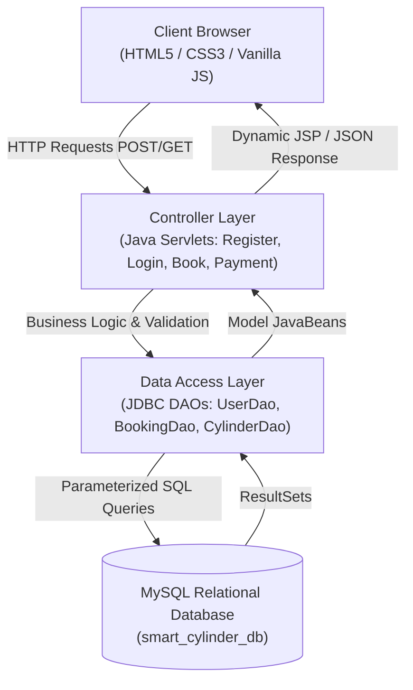
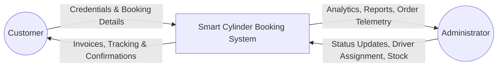
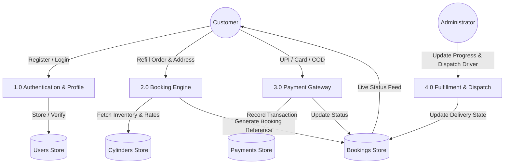
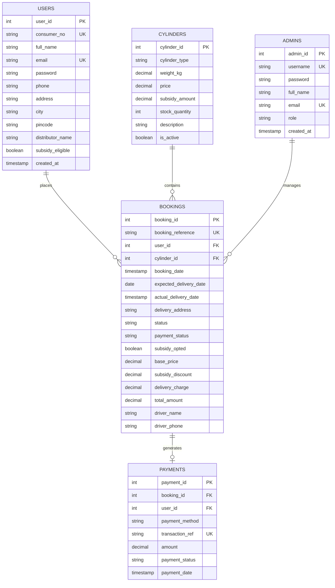

# PROJECT DESIGN REPORT (PDR)
## SMART CYLINDER BOOKING SYSTEM

---

### Project Information
- **Project Title:** Smart Cylinder Booking System
- **Academic Discipline:** Computer Science & Engineering / Information Technology
- **Domain:** Web Application & Database Management
- **Project Team Members & Roles:**
  1. **Avanya Sinha** — Frontend Engineering & UI/UX Design (HTML5, CSS3, JavaScript)
  2. **Mansi Kumari** — Database Architecture & SQL Engineering (MySQL, Schema Design, JDBC DAOs)
  3. **Deepshikha Kumari** — Backend Processing & Java Servlets (`jakarta.servlet.*`, Business Logic, Controllers)
  4. **Chanchal Goyal** — System Analysis, Data Flow Modeling & ER Diagrams
  5. **Kashish Kumari** — Software Testing, Security Validations & Quality Assurance

---

## 1. Introduction
The **Smart Cylinder Booking System** is an advanced web-based software application engineered to modernize, streamline, and automate the retail distribution and home delivery of Liquefied Petroleum Gas (LPG) cylinders. Serving as a unified online platform, the system bridges the gap between LPG consumers and regional gas distribution agencies.

Through the platform, customers can register for new connections, view verified cylinder catalogs (domestic and commercial), schedule doorstep refills, apply direct government subsidies (DBTL / PMUY), make secure payments, track the real-time fulfillment status of their orders, and access digitally verifiable tax receipts. Simultaneously, agency administrators gain comprehensive visibility over customer directories, stock levels, delivery fleet dispatch, and daily revenue collection.

---

## 2. Problem Statement
The conventional manual procedure for ordering and distributing LPG cylinders is burdened with systemic inefficiencies:
- **Lengthy Turnaround Times:** Consumers must visit distributor offices or rely on congested interactive voice response (IVR) phone queues during limited business hours.
- **Manual Record Bookkeeping:** Dependency on physical paper ledgers increases susceptibility to clerical errors, misplaced records, and duplicate entries.
- **Opacity in Order Fulfillment:** Consumers have no visibility into when their cylinder has departed the bottling depot or which delivery executive is en route.
- **Complex Subsidy Auditing:** Verifying customer eligibility for direct benefit transfers (DBTL) manually causes delays and accounting discrepancies.

The Smart Cylinder Booking System addresses these challenges by replacing paper-bound processes with a centralized digital ledger and intuitive web portals.

---

## 3. Objectives
- Establish a 24x7 automated online booking facility for domestic and commercial LPG cylinders.
- Streamline customer registration through automated generation of distinct 8-digit Consumer IDs.
- Enable direct government subsidy calculations (₹200 per refill) for eligible domestic connections.
- Support multi-channel electronic payments (UPI, Credit/Debit cards, Net Banking, and Cash on Delivery).
- Provide real-time milestone delivery tracking with delivery personnel assignment.
- Furnish agency administrators with dynamic KPI dashboards to oversee bookings, consumer rosters, and warehouse stock levels.
- Eliminate paperwork and reduce human administrative errors through transactional integrity.

---

## 4. Scope of the Project
The application caters to two primary user personas:

### Customer Persona:
- User registration and authenticated login.
- View available cylinder categories (14.2kg Subsidized, 14.2kg Non-subsidized, 19kg Commercial, 5kg Chhotu Mini, 47.5kg Industrial).
- Book refill with delivery date preference and address management.
- Multi-mode payment gateway integration with instant transaction generation.
- Real-time 5-stage visual delivery tracker (`Order Placed` ➔ `Confirmed` ➔ `Dispatched` ➔ `Out for Delivery` ➔ `Delivered`).
- Printable digital tax invoice generator.
- Profile and password management.

### Administrator Persona:
- Operations dashboard displaying real-time analytics (Total Customers, Bookings, Active Deliveries, Revenue, Stock).
- Order fulfillment controller: Update booking status and assign delivery personnel.
- Customer directory manager with search and subsidy filter.
- Inventory & pricing controller: Update refill rates, subsidies, and replenish warehouse stock units.

---

## 5. System Architecture & Data Flow

### 5.1 Architecture Diagram

### 5.2 Data Flow Diagram (DFD Level 0 - Context Level)

### 5.3 Data Flow Diagram (DFD Level 1)

---

## 6. Database Design (Entity-Relationship)

### 6.1 Mermaid Entity-Relationship Diagram (ERD)

---

## 7. Technologies Used

| Technology | Role in System | Description |
| :--- | :--- | :--- |
| **HTML5** | Content Structure | Semantic structure for landing pages, dashboards, booking forms, and invoices. |
| **CSS3** | Presentation & Responsive UI | Custom variables, flexbox, CSS grid, glassmorphism accents, and print stylesheets. |
| **JavaScript (ES6+)** | Client-Side Reactivity | Form validations, interactive stepper tracker, dynamic bill calculation, QR code generator. |
| **JSP (JavaServer Pages)** | Dynamic Server Rendering | Server-side templating displaying session-specific data and booking records. |
| **Java Servlets** | Controller & Business Logic | Processing HTTP POST/GET requests, session governance, and transaction orchestration. |
| **JDBC** | Database Connectivity | Type-4 native protocol driver (`com.mysql.cj.jdbc.Driver`) utilizing `PreparedStatement`. |
| **MySQL** | Relational Database | ACID-compliant storage of users, cylinders, bookings, payments, and admin logs. |
| **Apache Tomcat** | Web Application Server | Servlet container executing Java EE / Jakarta EE components on port 8080. |

---

## 8. Functional Requirements
- **FR-01 (Account Creation):** The system must generate a unique 8-digit Consumer Number (e.g., `LPG-10029384`) upon registration.
- **FR-02 (Authentication):** The system must validate email and password combinations and maintain session isolation between Customer and Administrator roles.
- **FR-03 (Subsidy Computation):** The system must automatically deduct the subsidy value (₹200) for eligible domestic accounts upon selection.
- **FR-04 (Inventory Protection):** The system must automatically decrement available cylinder stock count by 1 upon confirmed booking creation.
- **FR-05 (Payment Handling):** The system must support UPI, Card, Net Banking, and COD, recording a unique transaction reference and marking booking status as `CONFIRMED`.
- **FR-06 (Delivery Telemetry):** The system must provide a visual timeline tracking orders across 5 distinct milestones.
- **FR-07 (Administrative Control):** Administrators must have exclusive authority to modify order delivery statuses and assign driver contact numbers.

---

## 9. Non-Functional Requirements
- **Security:** Passwords are verified securely; parameterized SQL queries prevent SQL injection vulnerabilities.
- **Reliability & ACID Compliance:** All payment and booking transactions execute within database transactional blocks (`commit()` / `rollback()`).
- **Usability:** Intuitive layout with mobile-first responsive design, high-contrast badges, and clear typography.
- **Performance:** Pages render within sub-second thresholds; LocalStorage cache and indexed database queries ensure optimal throughput.
- **Maintainability:** Layered MVC architecture (Model-View-Controller) cleanly decouples database queries from user interface templates.

---

## 10. Software Testing & Quality Assurance

| Test Case ID | Test Scenario | Input Data | Expected Result | Actual Result | Status |
| :--- | :--- | :--- | :--- | :--- | :--- |
| **TC-01** | User Registration | Valid name, email, phone, 6-digit pin | Account created; unique Consumer No generated | Consumer ID assigned; session created | **PASS** |
| **TC-02** | Duplicate Email Registration | Existing email address | Error message displayed; registration blocked | Blocked with warning | **PASS** |
| **TC-03** | Customer Authentication | Valid email & password | Redirected to customer dashboard | Dashboard loaded | **PASS** |
| **TC-04** | Invalid Password Login | Correct email, wrong password | Error message "Invalid credentials" | Access denied | **PASS** |
| **TC-05** | Refill Booking with Subsidy | 14.2kg Subsidized Cylinder selected | Base ₹850 - ₹200 + ₹50 = ₹700 Total | Total calculated accurately as ₹700 | **PASS** |
| **TC-06** | Out of Stock Prevention | Cylinder with 0 stock units | Booking prohibited with alert | Order blocked with stock notification | **PASS** |
| **TC-07** | Payment Simulation | UPI VPA submitted | Payment marked PAID, Ref created, status CONFIRMED | Transaction recorded successfully | **PASS** |
| **TC-08** | Admin Status Modification | Change status from PENDING to DISPATCHED | Status updated; timeline changes to stage 3 | Timeline updated instantly | **PASS** |
| **TC-09** | Order Cancellation | Booking in PENDING state | Status changed to CANCELLED | Order cancelled successfully | **PASS** |
| **TC-10** | Invoice Print Render | Click "Print Receipt" | Modal renders printable clean layout | Print preview formatted | **PASS** |

---

## 11. Conclusion
The **Smart Cylinder Booking System** successfully demonstrates how modern web engineering, clean database normalization, and robust server-side Java technologies can resolve longstanding operational bottlenecks in the domestic energy distribution sector. The application provides consumers with peace of mind through transparent pricing, direct government subsidy administration, and real-time delivery visibility while empowering gas agencies with complete logistical oversight.

---

### Project Engineering Team Acknowledgement & Module Ownership
- **Avanya Sinha** — Frontend Engineering (HTML5, CSS3, Responsive UI & Client Interactions)
- **Mansi Kumari** — Database Architecture & SQL Engineering (MySQL Database, Tables & JDBC DAOs)
- **Deepshikha Kumari** — Backend Processing & Java Servlets (Controllers, Session Management & Business Logic)
- **Chanchal Goyal** — System Analysis, Data Flow Modeling (DFDs) & ER Diagrams
- **Kashish Kumari** — Software Testing, Security Validations & Quality Assurance
